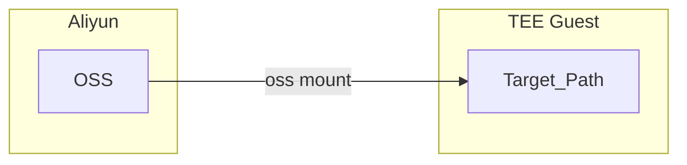
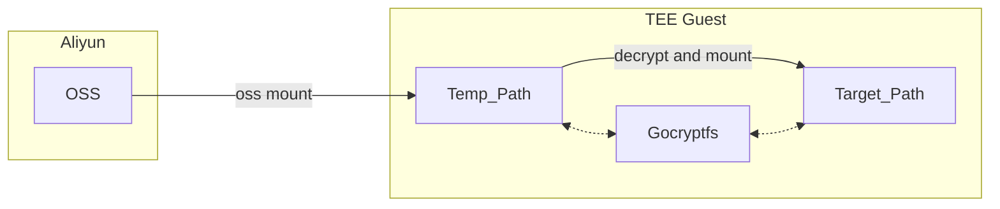
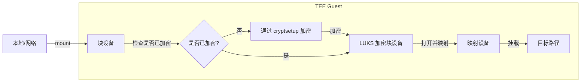

# 安全存储（Secure Storage）

## 目的

该安全存储特性的目的是：
1. 从 guest 而非宿主机挂载外部存储（再由宿主机共享给 guest），这是出于性能考虑。
2. 存储中的未加密数据只能在 TEE 内部被访问，这也是我们称之为安全存储的原因。

## 架构

首先，外部存储的敏感信息由来自 KBS/KMS 的密钥进行密封，并存储在 [密封密钥](https://github.com/confidential-containers/guest-components/blob/main/confidential-data-hub/docs/SEALED_SECRET.md) 中。敏感信息包括访问存储的 access key id / access key secret，以及存储在存储中的数据的加密密钥（例如 AI 模型），这也意味着我们支持客户端加密（client encryption）。
我们复用 [直接的块设备分配卷特性](https://github.com/kata-containers/kata-containers/blob/main/docs/design/direct-blk-device-assignment.md) 来直接从 guest 挂载外部存储。CSI 插件，例如 [阿里云 OSS CSI 插件](https://github.com/kubernetes-sigs/alibaba-cloud-csi-driver/blob/master/docs/oss.md)，从密封密钥读取敏感信息并传递给 kata agent。当 CDH 中的安全挂载（secure mount）服务收到安全挂载请求时，它会调用密封密钥服务来解封上述敏感信息，这个过程可以基于远程证明。如果成功，安全挂载服务将使用解封后的敏感信息来挂载外部存储并解密存储中的数据。

## 插件

### 阿里云 OSS

[阿里云 OSS](https://www.alibabacloud.com/product/object-storage-service) 是阿里云（Aliyun）提供的对象存储服务。

[该插件](../hub/src/storage/volume_type/aliyun) 提供两种不同的安全挂载模式。

机密数据中枢的 `secure_mount()` [API](../hub/protos/api.proto) 会协助编排这一过程。

#### OSS 中的明文数据

在这种模式下，被挂载的文件目录树以明文形式存储在 OSS 中。这暗示用户应当信任 OSS，因为 OSS 服务可以看到数据的明文。
架构图如下：

#### OSS 中的密文数据

在某些情况下，用户只想利用 OSS 的存储能力，同时又要保护数据的机密性与完整性。
[Gocryptfs](https://nuetzlich.net/gocryptfs/) 是一个用 Go 编写的加密覆盖式 fuse 文件系统。

阿里云 OSS + Gocryptfs 的组合插件将实现以下目标：
1. 文件以密文形式存储在阿里云 OSS 中。这意味着阿里云无法窃听或篡改数据。
2. 文件（目录树）可以被安全地以明文形式挂载到一个目标路径。

架构图如下：

更多细节，请参考 [该指南](use-cases/secure-mount-with-aliyun-oss.md)。

### 块设备

[该插件](../hub/src/storage/volume_type/blockdevice) 提供了加密块设备并将其挂载到指定挂载点的方式。

它支持**两种安全挂载模式**，由 `secure_mount()` 请求中的 `encryptionType` 字段选择：

- **LUKS2 模式（`"luks2"`）**：使用 `cryptsetup` 创建并打开一个 LUKS2 加密设备。
- **ZFS 模式（`"zfs"`）**：在块设备上创建的 ZFS 存储池（zpool）和加密数据集之上，使用 ZFS 原生加密。

在这两种模式下，明文设备（cleartext device）或文件系统只在 TEE guest 内部暴露。

#### 安全挂载模式概览

- **共同的请求形态**：两种模式都使用 `volume_type: "block-device"` 并共享相同的基础选项：
  - `deviceId` / `devicePath`：标识块设备。
  - `sourceType`：`"empty"`（新的/未加密的设备）或 `"encrypted"`（已存在的加密设备）。
  - `key`：从何处获取加密密钥（`"sealed.*"`、`"kbs://..."` 或 `"file://..."`）。
- **LUKS2 模式**：
  - 使用 `targetType` 来决定暴露明文**设备**（`"device"`）还是明文**文件系统**（`"fileSystem"`）。
  - 可通过 `dataIntegrity` 可选地启用 dm-integrity。
  - 使用由 `cryptsetup` 创建的 `/dev/mapper/<name>` 设备作为明文设备。
  - 当启用 dm-integrity 格式化为空的 ext4 文件系统时，CDH 默认将 `lazy_itable_init` 设为 `0`，除非调用方在 `mkfsOpts` 中显式提供了 `lazy_itable_init` 设置。
- **ZFS 模式**：
  - 始终在给定的 `mount_point` 提供文件系统挂载；`targetType` 当前被忽略，但为清晰起见应设为 `"fileSystem"`。
  - 添加 ZFS 特定选项：`pool`（zpool 名称，默认为 `zpool`）和 `dataset`（数据集名称，默认为 `zdataset`）。
  - 使用 ZFS 命令（`zpool`、`zfs`）来创建/导入 zpool、加载密钥并挂载加密数据集。

#### LUKS2 安全挂载模式

在这种模式下，设备将首先被加密为 LUKS2 设备，然后挂载到一个目标路径以存储数据，从而保护数据的机密性与完整性。

架构图如下：

#### ZFS 安全挂载模式

在这种模式下，块设备被用作 ZFS 存储池和加密数据集的后端存储：

- 当 `sourceType` 为 `"empty"` 时，CDH 会：
  - 在设备上创建一个新的 zpool（使用可选的 `pool` 名称或默认的 `zpool`）。
  - 在该池中创建一个加密数据集（使用可选的 `dataset` 名称或默认的 `zdataset`）并将其挂载到请求的 `mount_point`。
- 当 `sourceType` 为 `"encrypted"` 时，CDH 假定设备上已存在一个 zpool 和加密数据集，并会：
  - 从设备导入 zpool。
  - 使用提供的 `key` 将加密密钥加载到数据集中。
  - 将数据集挂载到请求的 `mount_point`。

该模式需要 `zfsutils-linux`（在 Ubuntu 上）以及一个已启用的 ZFS 内核模块。

关于两种模式的端到端请求示例，请参考 [该指南](use-cases/secure-mount-with-block-device.md)。
